# CD-Tag

Audio file tagging and renaming utility (WPF).

This is a fork of [judwhite/CD-Tag](https://github.com/judwhite/CD-Tag), which stopped in 2011–2016 as
an unfinished project. The fork brings it up to date:

- **.NET 10** (`net10.0-windows`) with SDK-style projects and `CDTag.slnx`.
- **Builds standalone**: the original author's tagging library, [IdSharp](https://github.com/judwhite/IdSharp),
  is vendored as a git subtree under `External/IdSharp`.
- **Dark mode**: *View → Theme* offers *Use Windows setting* (default), *Light* and *Dark*, switchable
  at runtime. Dark title bars and, on Windows 11, a Mica backdrop.
- **Tag Album** in the CD-Tag 2.x style: release page, lookup (MusicBrainz, CUETools DB), track preview,
  NFO/M3U/SFV creation, renaming and FLAC/MP3 tagging on *Finish*.
- **Rip**: reads the disc and looks it up (MusicBrainz disc ID, CUETools DB), then rips in test & copy mode with read
  offset correction (AccurateRip drive database), re-reads of mismatching blocks and an AccurateRip check per track;
  WAV, tagged FLAC or MP3, a CUE sheet, a log and the cover. Output folder, file naming, format and eject come from
  Exact Audio Copy's settings when EAC is installed.
- **Convert Audio**: WAV/FLAC to MP3 with LAME (`-V0` or `-b 320`), FLAC/MP3 to WAV.
- **Profiles**: edit, import from and export to CD-Tag 2.x (`.cfg` + NFO template).
- **Tools**: Split CUE (WAV/FLAC image to WAV or tagged FLAC tracks), Encoding Inspector (LAME tag with CRC checks,
  FLAC/WAV details), Create/Verify Checksum (SFV, MD5, SHA-1), Verify EAC Log (log checksum and rip checks) and Mass Tag.
- **LAME 3.100 and FLAC 1.5.0 built in**; drop in another version to use it instead.

## Screenshots

The music, artist and profile in these screenshots are examples made for this page.

**Tag/Rename and Convert Audio**

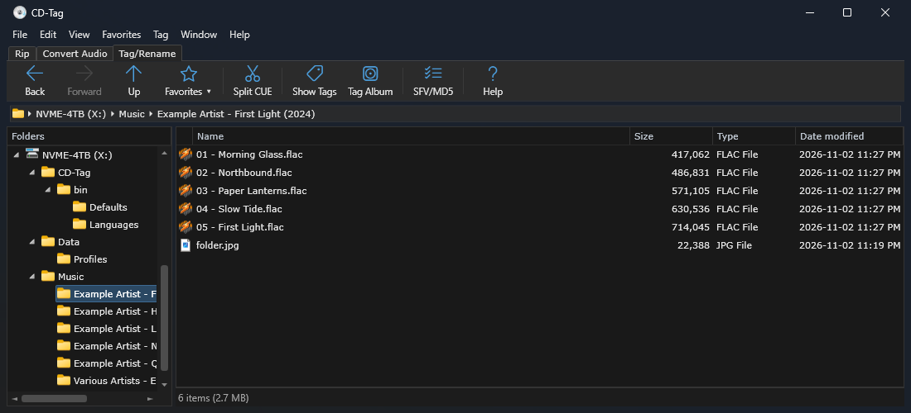
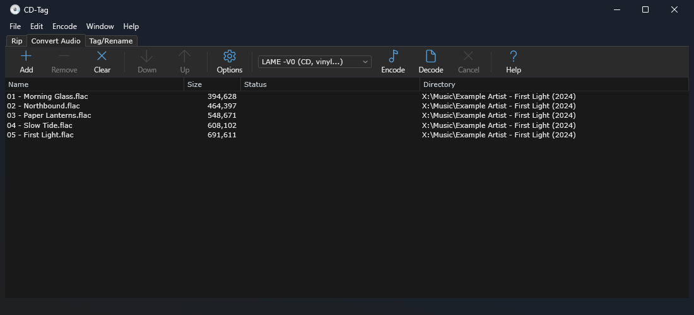

**Tag Album**: release page, track preview, album page, NFO preview and look up

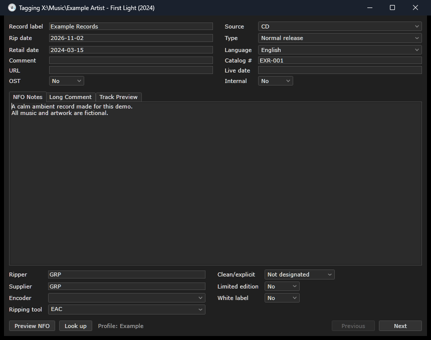
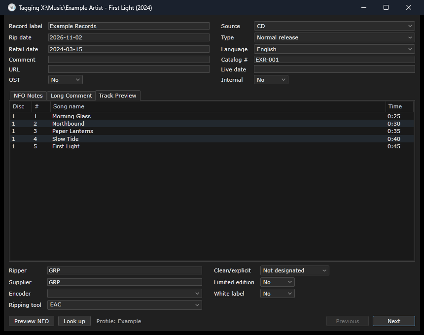
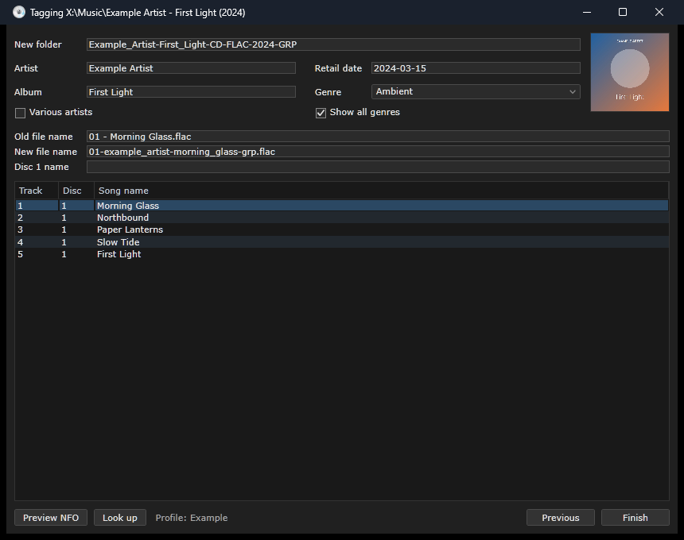
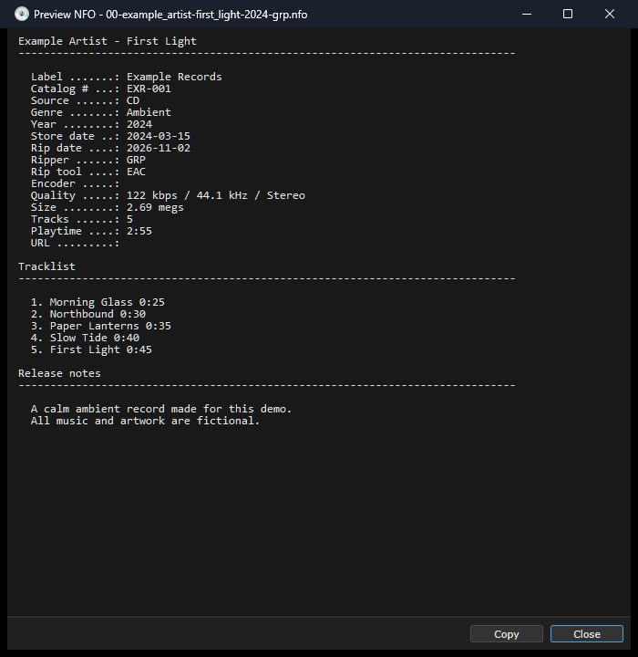
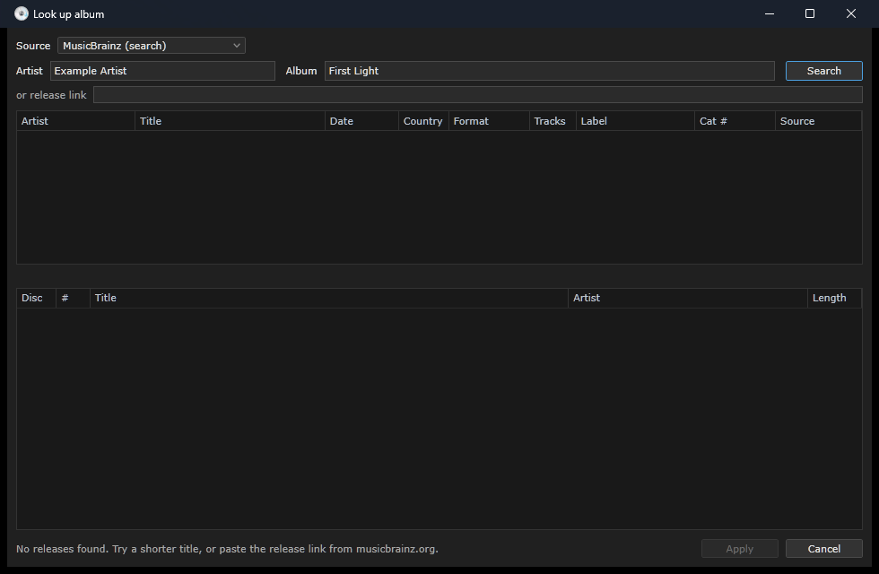

**Edit Profile**

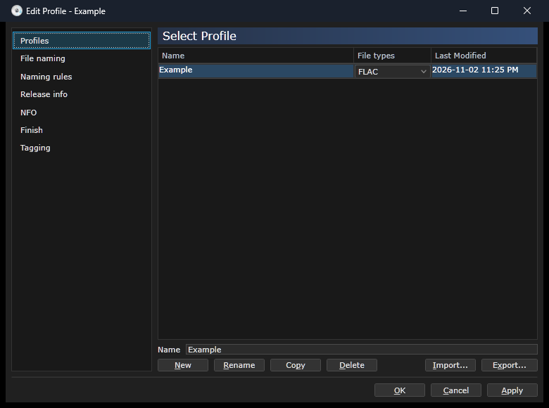
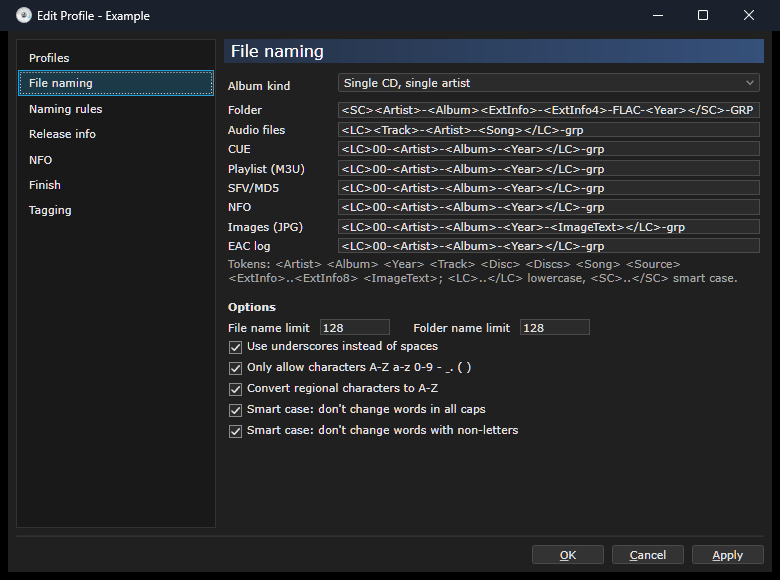
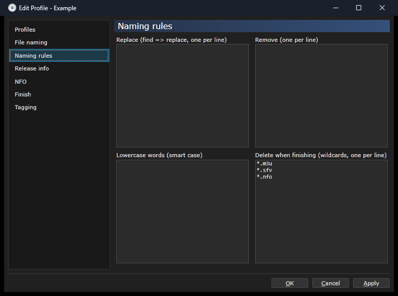
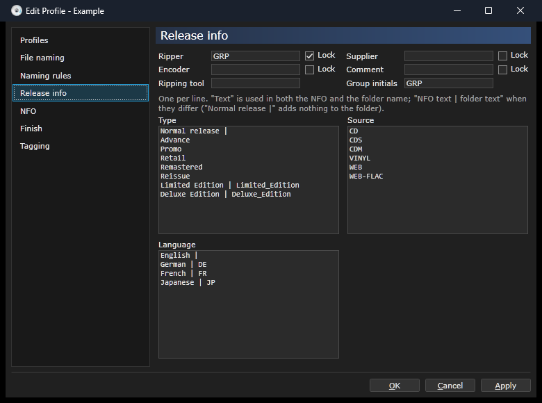
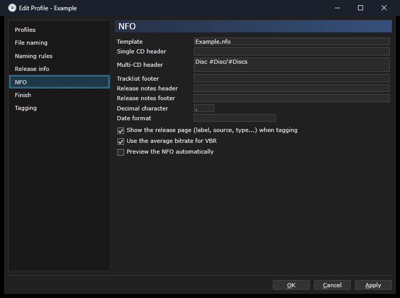
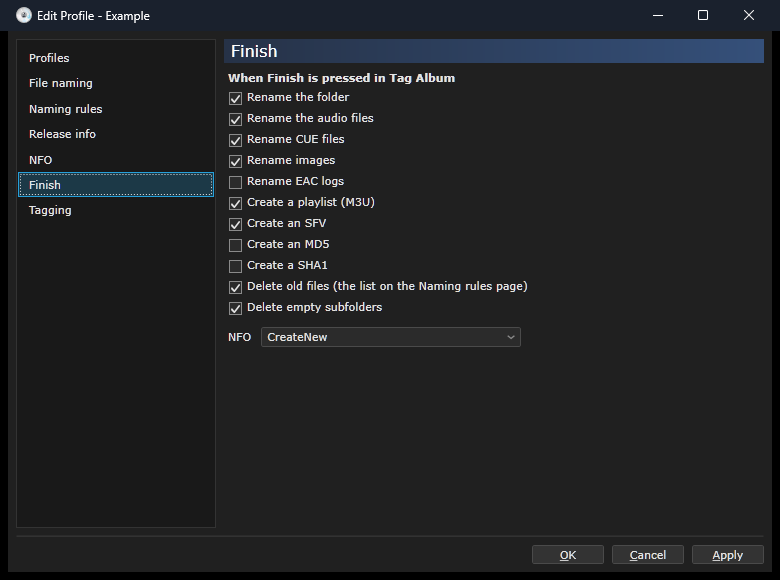
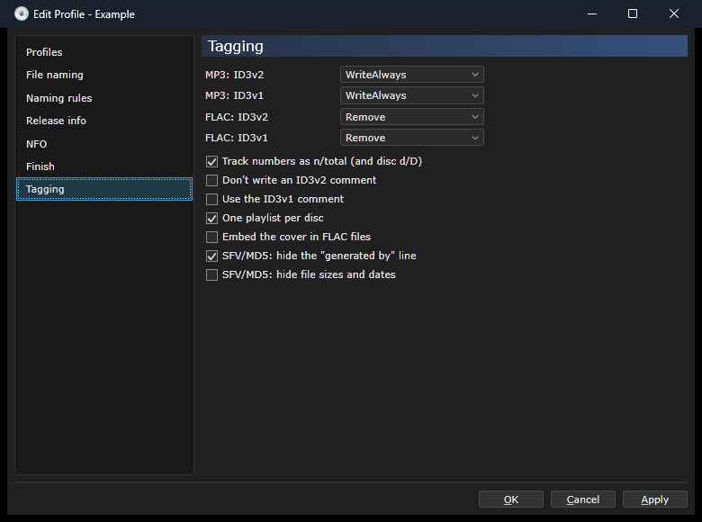

**Options, New Profile and About**

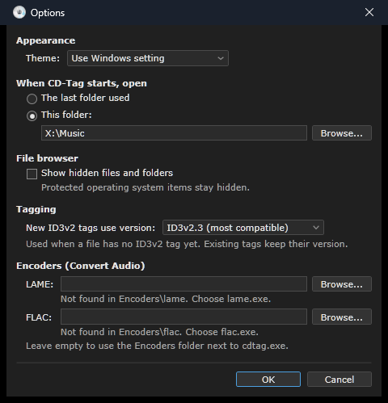
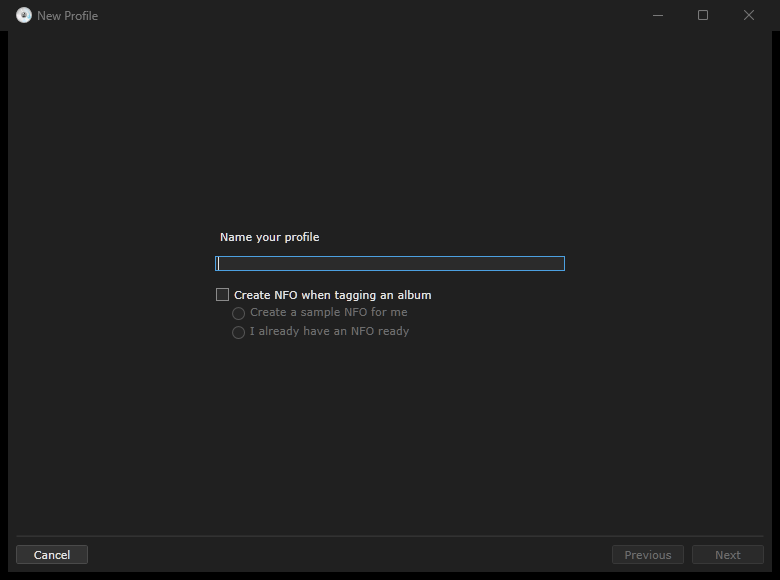
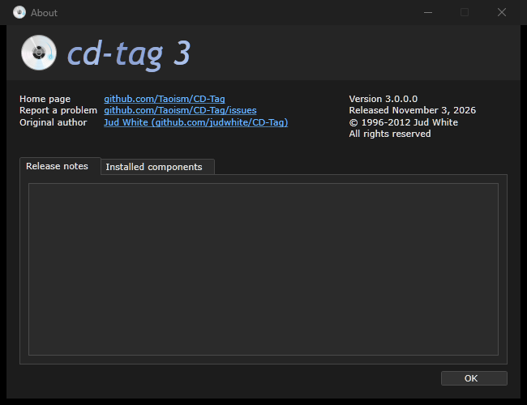

## Running a release

Unzip and run `cdtag.exe`. The release folder looks like this:

```
cdtag.exe       starter: installs the .NET 10 Desktop Runtime on first run if it is missing, then starts CD-Tag
options.json    options (see below)
Encoders\       your own lame.exe / flac.exe, if you want another version (see Encoders)
bin\            CD-Tag itself and its files, with the built-in LAME and FLAC
```

`cdtag.exe "D:\Rips\Album"` opens CD-Tag in that folder.

If the .NET 10 Desktop Runtime is missing, `cdtag.exe` downloads Microsoft's installer and runs it (Windows asks
for permission). If that is declined, a private copy is unpacked to `%LOCALAPPDATA%\CD-Tag\dotnet` instead.

## Encoders

CD-Tag comes with the newest **LAME 3.100** (64-bit) and **FLAC 1.5.0** (64-bit, from xiph.org), with their licenses
(LGPL; FLAC tools GPL, libFLAC BSD). They are used for Convert Audio, Split CUE and FLAC decoding.

To use another version, put it in the `Encoders` folder next to `cdtag.exe`; it is then used instead of the built-in one:

```
Encoders\mp3\lame.exe      your LAME (with lame_enc.dll if your build has one)
Encoders\flac\flac.exe     your FLAC (with libFLAC.dll if your build needs it)
bin\Encoders\lame\         built-in LAME 3.100
bin\Encoders\flac\         built-in FLAC 1.5.0
```

A path chosen in *Tools → Options → Encoders* wins over both. Options shows which one is in use.

When building from source, put the built-in encoders in `Encoders\lame\` and `Encoders\flac\` at the root of the
repository; the build copies them to `bin\Encoders` (Debug and Release). That folder is in `.gitignore`.

## options.json

A release has `options.json` next to `cdtag.exe`; CD-Tag reads and saves its options there (the same settings as
*Tools → Options*). Without that file, options are kept in `%LOCALAPPDATA%\CD-Tag\options.json`.

## Profiles

As in CD-Tag 2.x, profiles (`.cfg`) and their NFO templates (`.nfo`) are kept next to `cdtag.exe`: when that
folder has profiles, CD-Tag uses them. Otherwise they are kept in `%LOCALAPPDATA%\CD-Tag\Profiles`.

Profiles are saved in the CD-Tag 2.x format, so CD-Tag 2.x and this version can share the same files. Settings
2.x doesn't have are stored in a `[CDTAG3]` section, which 2.x ignores.

## NFO template

`bin\Defaults\blank.nfo` is a plain NFO template with every field. On first run it is copied to
the profile folder (unless that folder already has profiles); choose it on a profile's *NFO* page, or use it as a
starting point for your own. Profiles and NFO templates are not part of this repository.

## Building

Requirements: Windows, .NET 10 SDK (or Visual Studio 2026).

```
dotnet build CDTag.slnx
dotnet test CDTag.slnx
dotnet run --project CDTag
```

Release build (the layout above, in `publish\CD-Tag`):

```
dotnet publish CDTag\CDTag.csproj -c Release -o publish\CD-Tag
```

Settings are stored in `%LOCALAPPDATA%\CD-Tag` (`appearance.json`, `mainWindow.json`, `windows.json`, and `Profiles\` when there are no profiles next to `cdtag.exe`).

## Theming

All colours live in two palettes, `CDTag/Themes/Palettes/Light.xaml` and `Dark.xaml`, which define the
same keys. Styles in `CDTag/Themes/Default` only reference those keys with `DynamicResource`;
`CDTag.Views/Theming/ThemeManager.cs` swaps the palette at runtime. To add a colour, add the key to both
palettes.

## Updating IdSharp

```
git subtree pull --prefix=External/IdSharp https://github.com/judwhite/IdSharp.git master --squash
```

## License

IdSharp is MIT licensed (see `External/IdSharp/LICENSE`).
